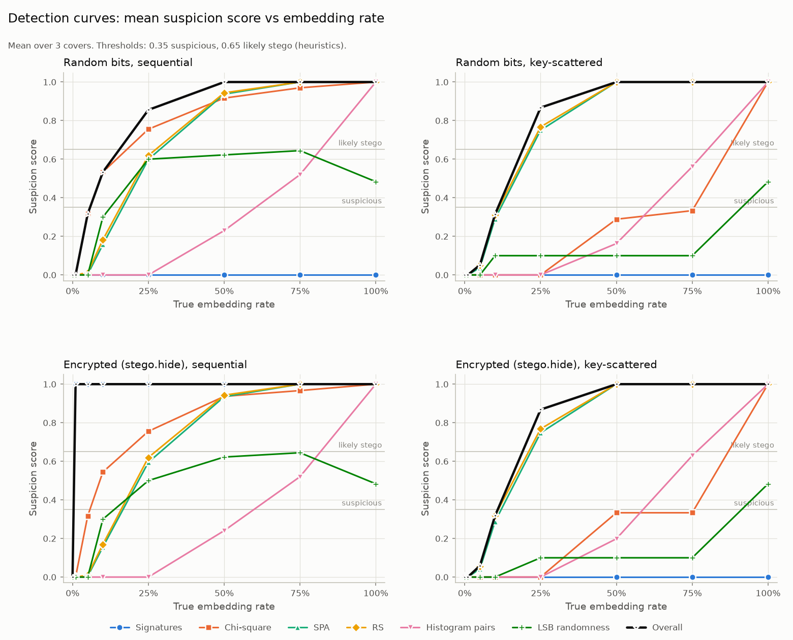
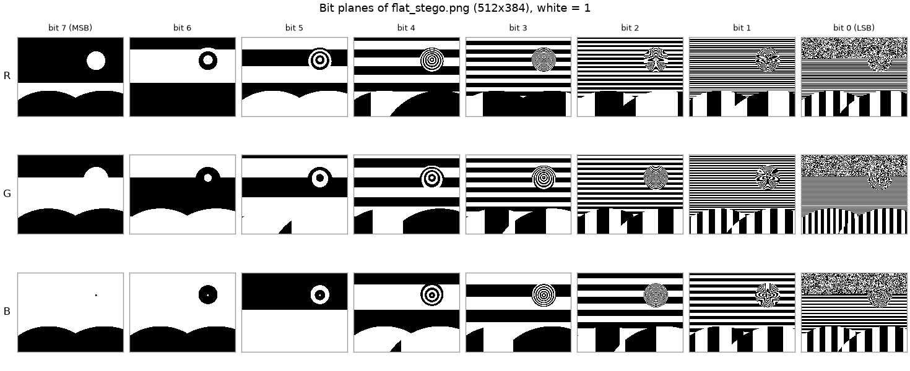
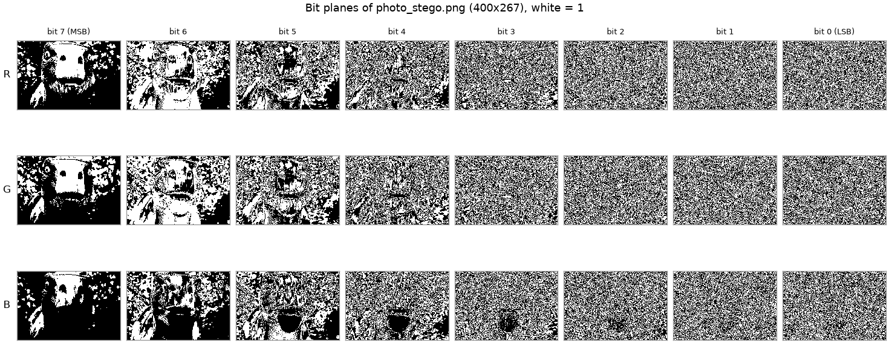
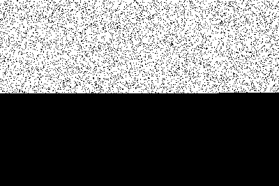
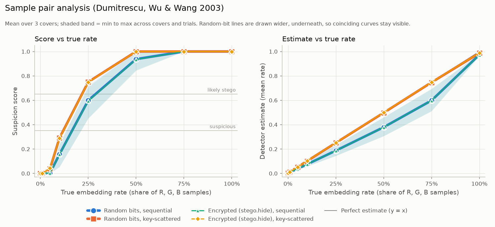
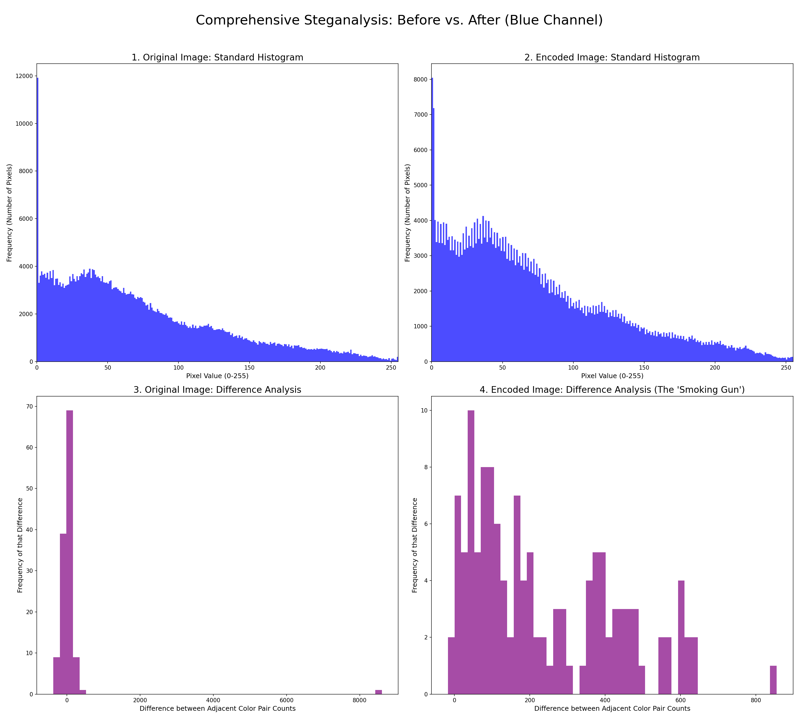

# Steganography Image Analyzer

Hide data in the least significant bits of images and audio, get it back out, and find data that someone else has hidden.

CS 5800 final project, Northeastern University, 2025. Author: Ethan Doherty.

**Contents:**
[Overview](#overview) |
[Features](#features) |
[Figures](#figures) |
[Install](#install) |
[Quick start](#quick-start) |
[Desktop app](#desktop-app-guipy) |
[How it works](#how-it-works) |
[Steganalysis methods](#steganalysis-methods) |
[Experiment results](#experiment-results) |
[Writing a plug-in](#writing-a-plug-in) |
[Project structure](#project-structure) |
[Testing](#testing) |
[Limitations and future work](#limitations-and-future-work) |
[License](#license) |
[References](#references-and-acknowledgments)

## Overview

Steganography hides a message inside something that looks ordinary. The most common technique, least significant bit (LSB) replacement, overwrites the lowest bit of each color value in an image (or each sample of an audio file) with one bit of the message. A value moves by at most 1 out of 255, which nobody can see or hear. That is why LSB steganography is easy to use and hard to notice by eye. It does leave statistical traces, though, and steganalysis is the work of measuring those traces.

The project began as *Hiding in Plain Sight*: a course project that hid text in PNG images and compared the color histograms of a cover image with its encoded version. This version works on both sides of the problem, and most of it does not need the original cover:

- **Hiding.** Text or whole files go into PNG, BMP, TIFF or WAV carriers inside a self-describing frame (length, CRC-32, optional zlib compression and AES-256-GCM encryption). With a password, the bits can also be scattered across the whole cover.
- **Finding and recovering.** Payloads are read back from a single suspect file. When the layout is unknown, about a hundred other bit layouts are tried (brute force), and hidden files are recognized by their signatures.
- **Detecting.** Blind statistical detectors (the chi-square attack, sample pair analysis, RS analysis, a histogram-pair heuristic and randomness tests) estimate whether, and how much, LSB data is present, even when it cannot be read. Bit-plane views and the original cover-versus-stego histograms are there for visual checks.

It comes as a Tkinter desktop app (`gui.py`), a command line (`main.py`) and a set of importable Python modules, all built on the same code. Carriers (cover formats) and detectors are plug-ins, so a new format or test can be added without touching the rest.

## Features

| Capability | Where |
|---|---|
| **Identify and decode LSB payloads** in PNG, BMP and TIFF images and 8/16-bit PCM WAV audio, at 1 or 2 bits per sample. Covers can be any image Pillow reads, JPEG included; output is always lossless. | `stego.py`, `carriers/`, `decoder.py` |
| **Reconstruct hidden messages and files**: text comes back as text; files come back under their stored names. Images in the project's original format (text plus a 64-zero-bit marker) are still read. | `stego.reveal`, `stego.save_payload`, `decoder.decode_legacy` |
| **Brute-force decoding strategies**: 108 bit layouts by default (channel order x bit plane x bit order x row/column traversal, plus 2-bit layouts), ranked by heuristic scores. Recognizes text, this project's frames and hidden files (PNG, JPEG, GIF, ZIP, PDF, GZIP, BMP, WAV and more). A password word list can be tried against payloads scattered with a password. | `bruteforce.py` |
| **Bit-plane visualization**: any bit plane of any channel, a full bit-plane grid, an amplified-LSB image, and a mask of the pixels whose LSBs changed between a cover and a stego image. | `bitplanes.py` |
| **Histogram comparison**: standard and even/odd pair-difference histograms of a cover and its stego version, with L1, L2, median and maximum pair statistics. | `steganalysis.py`, `pairwise_stats.py` |
| **Entropy heuristics and randomness testing** to spot encrypted or compressed payloads: byte entropy, monobit, runs and byte chi-square tests on the LSB stream, plus LSB spatial correlation. | `detectors/randomness.py` |
| **Statistical detectors**: chi-square attack (Westfeld & Pfitzmann 1999), sample pair analysis (Dumitrescu, Wu & Wang 2003), RS analysis (Fridrich, Goljan & Du 2001), a histogram-pair heuristic and a signature scan. SPA and RS estimate *how much* of the image carries payload. | `detectors/` |
| **Password protection**: AES-256-GCM with a scrypt-derived key, plus key-scattered embedding (a password-derived pseudo-random order of samples). Optional zlib compression. | `payload.py`, `carriers/base.py` |
| **Plug-in architecture**: carriers and detectors register themselves; the CLI, GUI, reports and brute force pick them up automatically. | `carriers/__init__.py`, `detectors/__init__.py` |
| **Reports**: one-image analysis as a terminal summary, Markdown (with figures), self-contained HTML, or JSON. | `report.py` |
| **Experiments**: detection curves for every detector across embedding rates, with CSV, JSON, LaTeX and figures. | `make_all.py` |
| **Three front ends**: Tkinter desktop app, command line, Python API. Pure Python, so it runs wherever Python 3.11+ and Tk run. Developed on macOS; a GitHub Actions workflow runs the test suite on Ubuntu; Windows has not been tested. | `gui.py`, `main.py` |
| **482 automated tests.** | `tests/` |

## Figures

Every figure below was produced by this repository's own code.

**Detection curves.** Mean suspicion score of every detector as the embedding rate grows, for four kinds of payload. From `python make_all.py detection --tag detection-demo`; the numbers are in [Experiment results](#experiment-results).



**The visual attack works on clean graphics.** Bit planes of a noise-free, computer-generated 512x384 picture after 20,000 random bytes (27% of capacity) were hidden in natural order. In the bit 0 column (right) the payload is the noisy band across the top; below it, the LSB plane still shows the picture's smooth gradient stripes.



**It fails on photos.** The same kind of payload (50% of capacity, encrypted, natural order) in a 400x267 photo (`results/stego_resized.png`). The photo's own sensor noise already makes bits 0 to 3 look random, so the bit planes (left) show nothing. With the original cover at hand, the LSB difference mask (right, white = changed) shows exactly where the payload went: the top half. Without the cover, the statistical detectors are needed.

| Bit planes of the stego photo | LSB difference mask vs the cover |
|---|---|
|  |  |

**Estimates, not just alarms.** Sample pair analysis estimates the share of samples that carry payload. On key-scattered payloads its estimate is within 0.01 of the truth on average (right panel, upper lines).



**Cover vs stego histograms** (the original project's analysis, now the Compare tab). Blue channel of the 400x267 photo filled to capacity with Lorem ipsum in the original text format. The text payload leaves a "comb": in the stego image, almost every even value outnumbers its odd neighbour (panel 2), and the pair differences shift to the positive side (panel 4).



<!-- TODO (Ethan): add a screenshot of the desktop app, e.g. docs/figures/gui_analyze.png. -->

## Install

Requires Python 3.11 or newer. Tested with Python 3.13.7, numpy 2.5.4, Pillow 12.3.0, matplotlib 3.11.2, scipy 1.18.1 and cryptography 50.0.2 on macOS.

```bash
git clone https://github.com/edoherty2017/steganography-image-analyzer.git
cd steganography-image-analyzer
python3 -m venv .venv
source .venv/bin/activate          # Windows: .venv\Scripts\activate
pip install -r requirements.txt    # or requirements-dev.txt to also get pytest
```

`pip install .` also works. It installs the modules and a `stego-analyzer` command that is the same as `python main.py`. The modules are installed under their plain names (`main`, `stego`, `report`, and so on), so install into a dedicated virtual environment.

`tkinter` is only needed for the desktop app. It is part of the Python standard library and cannot be installed with pip:

- The python.org installers for macOS and Windows already include it.
- Homebrew Python on macOS needs the formula that matches your Python version, for example `brew install python-tk@3.13`.
- On Debian or Ubuntu: `sudo apt install python3-tk`.

## Quick start

The commands below were run exactly as shown. They use a scratch folder and the clean 400x267 photo committed as `results/stego_resized.png`:

```bash
mkdir -p demo && cp results/stego_resized.png demo/cover.png && cd demo
```

Every subcommand has `-h`. Exit status is 0 on success, 1 on an error or when nothing is found (message on stderr as `main.py: error: ...`), 2 for invalid arguments.

### Hide and reveal a message

```console
$ python ../main.py capacity -i cover.png
cover.png (image-lsb): 320,400 samples
  1 bit/sample:  40,036 bytes of data
  2 bits/sample: 80,086 bytes of data

$ python ../main.py encode -i cover.png -m "Meet me at noon." -o stego.png
Successfully encoded message in 'stego.png'
  16 bytes of data in a 30-byte frame, 0.07% of capacity (image-lsb, 1 bit(s)/sample, not encrypted, sequential)

$ python ../main.py decode -i stego.png
Decoded Message Found:
Meet me at noon.
```

The output must be lossless. A `.jpg` output is refused and nothing is written:

```console
$ python ../main.py encode -i cover.png -m "hi" -o out.jpg
main.py: error: .jpg is a lossy format and would destroy the hidden bits; save as one of: .png, .bmp, .tif, .tiff
```

### With a password

The password encrypts the payload (AES-256-GCM) and, unless `--no-scatter` is given, also scatters its bits over the whole image. `--password-prompt` asks for it without echo; when stdin is not a terminal it reads one line, which is how these examples pass it. (`--password PW` also works but shows up in the process list and shell history.)

```console
$ echo "correct horse" | python ../main.py encode -i cover.png -m "The key is under the mat." -o secret.png --password-prompt
Successfully encoded message in 'secret.png'
  25 bytes of data in a 83-byte frame, 0.21% of capacity (image-lsb, 1 bit(s)/sample, encrypted, scattered)

$ echo "correct horse" | python ../main.py decode -i secret.png --password-prompt
Decoded Message Found:
The key is under the mat.

$ echo "wrong guess" | python ../main.py decode -i secret.png --password-prompt
main.py: error: no STGA payload found in 'secret.png' at 1 or 2 bits per sample; with key scatter a wrong password reads the bits in the wrong order, so a wrong password looks the same as no payload; the legacy delimiter format was not found either
```

### Hide a file, with compression, at 2 bits per sample

```console
$ python ../main.py encode -i cover.png -f notes.txt -o filestego.png --compress --bits 2
Successfully hid file 'notes.txt' in 'filestego.png'
  860 bytes of data in a 84-byte frame, 0.10% of capacity (image-lsb, 2 bit(s)/sample, not encrypted, sequential, compressed)

$ python ../main.py decode -i filestego.png
Hidden file found: 'notes.txt' (860 bytes). Use --out DIR to save it.

$ python ../main.py decode -i filestego.png --out recovered/
Saved 860 bytes to 'recovered/notes.txt'
```

Any file works; `notes.txt` here is 860 bytes of repeated text, which compresses to a 70-byte body. `decode` never prints binary data. `--out DIR/` (or an existing folder) keeps the stored file name and never overwrites; any other `--out PATH` is written exactly there.

### Audio carrier (WAV)

```console
$ python -c "import wave,numpy as np; t=np.arange(44100)/44100; s=(0.3*np.sin(2*np.pi*440*t)*32767).astype('<i2'); w=wave.open('tone.wav','wb'); w.setnchannels(1); w.setsampwidth(2); w.setframerate(44100); w.writeframes(s.tobytes()); w.close()"

$ python ../main.py encode -i tone.wav -m "hi from the audio track" -o tone_stego.wav
Successfully encoded message in 'tone_stego.wav'
  23 bytes of data in a 37-byte frame, 0.67% of capacity (wav-lsb, 1 bit(s)/sample, not encrypted, sequential)

$ python ../main.py decode -i tone_stego.wav
Decoded Message Found:
hi from the audio track
```

### Images in the original format

Stego images written by the first version of this project (text followed by 64 zero bits) are still read:

```console
$ python ../main.py decode -i ../results/stego_encoded.png
note: no STGA frame; read the legacy delimiter format (text followed by 64 zero bits)
Decoded Message Found:
I am a sneaky dino!! Knowbody knows im here!!
```

### Analyze a suspect image

`analyze` runs every detector, looks for a payload header, tries the brute-force layouts and prints a summary. On the clean cover:

```console
$ python ../main.py analyze -i cover.png
Image:    cover.png (PNG, RGB, 400x267)
Capacity: 40,036 bytes at 1 bit/sample, 80,086 at 2
Verdict:  CLEAN (score 0.07, driven by rs_analysis)
          No detector reached the suspicious level; the strongest signal was rs_analysis (0.07): Estimated LSB embedding rate 6.3% (channel B); mean over channels 3.5%.
Payload:  none found in natural order (a password-scattered payload needs its password)

Detectors:
  signatures             clean         0.00  No payload header, file signature or readable text in the LSB streams.
  chi_square             clean         0.00  Inconclusive: the histogram is so smooth that even the control pairs are balanced, so the chi-square attack cannot separate payload from cover here.
  sample_pair_analysis   clean         0.02  Estimated LSB embedding rate 5.3% (channel B); mean over channels 2.9%.
  rs_analysis            clean         0.07  Estimated LSB embedding rate 6.3% (channel B); mean over channels 3.5%.
  histogram_pairs        clean         0.00  Even/odd pairs keep their natural imbalance (ratio 1.00 against control pairs); no sign of LSB replacement.
  lsb_randomness         clean         0.00  LSB plane is structured (entropy 7.983 bits/byte, monobit z -0.2, runs z 0.3); no random-looking payload region.

Brute force (best layouts):
  0.00  RGB bit0 msb-first row     binary     binary, entropy 7.95 bits/byte: d5 0f e1 fb 83 71 72 ae f0 54 0f 5a dd 36 7d 71
  0.00  RGB bit0 msb-first col     binary     binary, entropy 7.94 bits/byte: c4 85 77 d6 8b 3c 33 e5 40 09 01 ff 0b 58 f8 2f
  ...

Scores are heuristics, not probabilities; see report.py.
```

On `stego.png` from above, the frame header is found and the message is read back:

```console
$ python ../main.py analyze -i stego.png --no-bruteforce
...
Verdict:  LIKELY STEGO (score 1.00, driven by payload)
          Found a readable STGA payload: 16-byte body at 1 bit(s) per sample, CRC-32 verified.
Payload:  STGA frame, 16-byte body, 1 bit(s)/sample; sequential
          "Meet me at noon."
...
```

A short payload scattered with a password (`secret.png`) is invisible: every detector reads it as clean (score 0.08). A large one is not. Here 20,000 random bytes (50% of capacity) are hidden with a password, so they are both encrypted and scattered:

```console
$ head -c 20000 /dev/urandom > blob.bin
$ echo "correct horse" | python ../main.py encode -i cover.png -f blob.bin -o half.png --password-prompt
Successfully hid file 'blob.bin' in 'half.png'
  20,000 bytes of data in a 20,068-byte frame, 50.11% of capacity (image-lsb, 1 bit(s)/sample, encrypted, scattered)

$ python ../main.py analyze -i half.png --no-bruteforce
Image:    half.png (PNG, RGB, 400x267)
Capacity: 40,036 bytes at 1 bit/sample, 80,086 at 2
Verdict:  LIKELY STEGO (score 1.00, driven by sample_pair_analysis)
          Estimated LSB embedding rate 57.3% (channel B); mean over channels 52.9%.
Payload:  none found in natural order (a password-scattered payload needs its password)

Detectors:
  signatures             clean         0.00  No payload header, file signature or readable text in the LSB streams.
  chi_square             clean         0.00  Inconclusive: the histogram is so smooth that even the control pairs are balanced, so the chi-square attack cannot separate payload from cover here.
  sample_pair_analysis   likely_stego  1.00  Estimated LSB embedding rate 57.3% (channel B); mean over channels 52.9%.
  rs_analysis            likely_stego  1.00  Estimated LSB embedding rate 59.6% (channel B); mean over channels 54.0%.
  histogram_pairs        likely_stego  0.98  Even/odd pairs are flattened (ratio 0.11, channel G); consistent with LSB replacement by random-looking (encrypted or compressed) bits.
  lsb_randomness         clean         0.30  LSB plane is statistically random: typical of a noisy photo, and also what an encrypted or compressed payload looks like; not evidence on its own.

Scores are heuristics, not probabilities; see report.py.
```

The payload cannot be read without the password, but sample pair analysis and RS analysis both measure it: a mean rate of 53% and 54% against the true 50%. With the password, `analyze --password-prompt` also decrypts it.

Reports and JSON:

```console
$ python ../main.py analyze -i half.png --report reports/ --format html
...
Report written to 'reports/half_report.html'

$ python ../main.py analyze -i half.png --report reports/      # Markdown (default) + 3 PNG figures
$ python ../main.py analyze -i stego.png --json > stego.json    # stdout carries only JSON
```

Markdown and HTML reports include a bit-plane grid, an amplified-LSB image and the even/odd value histograms (`--no-figures` skips them). The HTML page is self-contained.

### Bit planes and LSB differences

```console
$ python ../main.py bitplanes -i half.png -o planes.png --diff cover.png --amplify lsb.png
Bit-plane grid written to 'planes.png'
Amplified LSB image written to 'lsb.png'
LSB diff written to 'planes_lsb_diff.png': 61,989 of 106,800 pixels (58.04%) have a changed LSB
```

`--channels RGBA` adds the alpha row when the image has one.

### Brute force

Brute force reads the first 4 KB under each of the 108 layouts and ranks what comes out. On an image from the original encoder:

```console
$ python ../main.py bruteforce -i ../results/stego_encoded.png --top 3 --save recovered/
score  layout                     kind       preview
 0.86  RGB bit0 msb-first row     text       I am a sneaky dino!! Knowbody knows im here!!
 0.02  R bit0 msb-first col       text       !t\n憱.Ig
 0.00  RGB bit0 msb-first col     binary     binary, entropy 7.82 bits/byte: 4b 00 05 17 61 80 01 28 b8 d7 11 23 89 b1 78 a2 ...
Saved best candidate to 'recovered/bruteforce_RGB_bit0_msb_row.txt'
```

A payload scattered with a password looks like noise in every layout. `--wordlist` tries each line of a file as the password:

```console
$ printf 'password\nletmein\ncorrect horse\ndragon\n' > words.txt
$ python ../main.py bruteforce -i secret.png --top 1 --wordlist words.txt
score  layout                     kind       preview
 0.00  RGB bit0 msb-first row     binary     binary, entropy 7.95 bits/byte: d5 0f e1 fb 83 71 72 ae f0 54 0f 5a dd 36 7d 71 ...
wordlist: password 'correct horse' (1 bit/sample): The key is under the mat.
```

`--max-bit N` searches bit planes 0 to N (default 1), `--json` prints machine-readable output.

### Compare a cover and a stego image

```console
$ python ../main.py compare cover.png half.png -o plots/comparison.png
Comparison figure written to 'plots/comparison.png'
  also 'plots/1_original_standard_hist.png'
  also 'plots/2_encoded_standard_hist.png'
  also 'plots/3_original_difference_analysis.png'
  also 'plots/4_encoded_difference_analysis.png'
Even/odd pair statistics, blue channel (Delta_k = h(2k) - h(2k+1)):
  cover: L1 3,184  L2 540.6  median |Delta| 17  max |Delta| 429 at k=0
  stego: L1 2,928  L2 382.7  median |Delta| 15  max |Delta| 147 at k=0
61,989 of 106,800 pixels (58.04%) have a changed R, G or B LSB
```

`--channel r|g|b` picks the channel (default `b`).

### List the plug-ins

```console
$ python ../main.py plugins
Carriers (cover formats, carriers/ package):
  image-lsb    LSB replacement in the R, G, B channels of PNG/BMP/TIFF images
               writes: .png .bmp .tif .tiff
               also reads covers: .jpg .jpeg .jpe .jfif .gif .webp .ppm .pgm .pbm .pnm .tga
  wav-lsb      LSB replacement in 8-bit / 16-bit PCM WAV samples
               writes: .wav
Detectors (detectors/ package):
  signatures             Scans the first few KB of the LSB stream in common orders for this project's STGA header, common file magic numbers and readable text.
  chi_square             Chi-square attack on pairs of values (Westfeld & Pfitzmann 1999) over growing prefixes of the sample stream; detects sequential LSB embedding.
  ...
Brute-force layouts: 108 by default (bruteforce.enumerate_strategies), plus a password word-list attack
Report formats: md, json, html
```

### Experiments

```bash
python ../make_all.py detection --quick --out /tmp/exp       # two 128 px synthetic covers, 4 rates (about 3 s)
python ../make_all.py detection --tag my-run                 # the full run (about 8 s), into results/experiments/my-run/
python ../make_all.py classic cover.png --out classic/        # the original three histogram cases
```

See [Experiment results](#experiment-results).

### From Python

```python
import stego, detectors, report, bitplanes, bruteforce

stego.capacity_bytes("cover.png")                         # 40036 bytes at 1 bit/sample
stego.hide("cover.png", "stego.png", "meet at noon", password="pw")
stego.reveal("stego.png", password="pw").text()           # 'meet at noon'
stego.probe("stego.png")                                  # None: scattered, needs the password

stego.hide("cover.png", "files.png", open("notes.txt", "rb").read(),
           filename="notes.txt", compress=True, bits=2)
found = stego.reveal("files.png", bits=None)              # bits=None tries 1, then 2
stego.save_payload(found, "recovered/")                   # recovered/notes.txt, never overwrites

results = detectors.run_all("stego.png")                  # {name: {score, verdict, summary, details}}
detectors.combine_results(results)["verdict"]             # 'clean' (a short scattered payload)

result = report.analyze_image("files.png")                # one JSON-serializable dict
print(report.format_text(result))
report.write_report(result, "reports/", fmt="html")       # reports/files_report.html

bitplanes.save_bitplane_grid("files.png", "planes.png")   # rows R, G, B; columns bit 7..0
mask = bitplanes.lsb_diff("cover.png", "files.png")       # 255 where any LSB changed

best = bruteforce.bruteforce("files.png", top_k=3)[0]     # ranked candidates
best["label"], best["kind"], best["score"]                # ('RGB bits1-0 msb-first row', 'stga', 1.0)
hits = bruteforce.dictionary_attack("stego.png", ["123456", "pw"])
hits[0]["password"]                                       # 'pw'
```

The original entry points still work: `encoder.encode(image, message, output)` returns the output path, and `decoder.decode(image, password=None)` returns the text or `None`.

## Desktop app (`gui.py`)

```bash
python gui.py
```

A Tkinter (ttk) window titled "Steganography Image Analyzer" with six tabs. Slow work (hiding, analysis, brute force, figures) runs on a worker thread, so the window stays responsive.

| Tab | What it does |
|---|---|
| **Encode** | Pick a cover (PNG, BMP or TIFF; JPEG, GIF and other Pillow formats as a cover only; 8/16-bit PCM WAV). Type a message or choose a file. Options: password (masked, with Show), "scatter bits using the password", zlib compression, 1 or 2 bits per sample. A live meter compares the payload's size (UTF-8 bytes plus the exact frame overhead) with the cover's capacity and turns red when it does not fit. The stego file can only be saved in a lossless format. Previews: cover, stego, and the pixels whose LSBs changed. |
| **Decode** | Recovers a payload (bits Auto/1/2, optional password) and falls back to the original delimiter format. Text is shown inline; a file or binary data is shown as a hex dump and can be saved under its stored name (never overwriting). A wrong password, no payload and a damaged payload each get their own message. With key scatter, a wrong password looks the same as no payload. |
| **Analyze** | Runs the full analysis (every detector, header detection, optional brute force, optional password) and shows a colored verdict banner, a table of detectors with score, verdict and summary, the text summary, and the selected detector's details as JSON. "Export report" writes Markdown, HTML or JSON. |
| **Bitplanes** | Choose a channel (R, G, B, and A when present) and a bit (7 to 0) to see that plane and its share of 1 bits; also the amplified LSB image and the full bit-plane grid. This is the visual attack, a heuristic. |
| **Brute force** | Tries the bit layouts (top N and the highest bit plane are settable) and lists candidates with strategy, kind, score and preview; any candidate can be saved. A password list can be tried against password-scattered payloads. |
| **Compare** | The cover-vs-stego histogram comparison for R, G or B, the even/odd pair statistics for both images, and an LSB-difference mask with a count of changed pixels. |

Toolbar: **Open...** (loads into the current tab; Ctrl/Cmd+O), **Resize for Test** (a copy of the cover that fits in 400x400), **Fill Max Space** (Lorem ipsum that fills exactly the cover's capacity, for a full-rate demo) and **Reset All**. **Help > About** lists the registered carrier and detector plug-ins. File dialogs are built from the carrier registry, so a new carrier's formats appear automatically. Generated figures and the resized cover go to `results/` in the current directory (created when first needed); stego files, recovered payloads and reports go where you choose.

## How it works

### The payload frame (`payload.py`)

Everything that is hidden is wrapped in a self-describing frame: a 14-byte big-endian header, then the body.

| Offset | Size | Field |
|---|---|---|
| 0 | 4 | Magic `STGA` |
| 4 | 1 | Version (1) |
| 5 | 1 | Flags: `0x01` encrypted, `0x02` file, `0x04` compressed. Any other bit makes the header invalid. |
| 6 | 4 | Body length (uint32) |
| 10 | 4 | CRC-32 of the body (`zlib.crc32`) |
| 14 | n | Body |

The body is built in three steps, so a file name is hidden by compression and encryption too:

1. If a file name is given, the record starts with a 2-byte name length and the UTF-8 name (directories are stripped), followed by the data.
2. If compression is requested, the record is zlib-compressed.
3. If a password is given, the record is encrypted with AES-256-GCM. The key comes from scrypt (n = 2^14, r = 8, p = 1, a random 16-byte salt, 32-byte key). The encrypted body is `salt (16) | nonce (12) | ciphertext + tag (16)`, so encryption adds exactly 44 bytes.

On the way back, the CRC is checked before decryption, so a damaged image (`PayloadError`) and a wrong password (`WrongPasswordError`) give different errors. The CRC only detects accidental damage; the GCM tag is what protects an encrypted frame against tampering. Decompression is capped at 256 MiB.

The frame replaces the original format, which stored `ord()` codes followed by 64 zero bits. That format could not hold binary data or text with NUL characters, broke on characters above U+00FF, and cut off messages whose last character ended in zero bits (`"abcd"` came back as `"abc"`). The old images are still readable (`decoder.decode_legacy`, which searches for the marker only at byte boundaries).

### Embedding order

A carrier is a flat sequence of integer samples:

- **Images:** the R, G and B values of every pixel, pixels in row-major order (left to right, top to bottom) and R, G, B within a pixel. Alpha is never used and is written back unchanged. Palette and grayscale covers are converted to RGB (RGBA when they have transparency).
- **WAV:** the PCM samples in file order, channels interleaved (8-bit unsigned or 16-bit signed). All WAV parameters are kept.

The frame's bits (most significant bit of each byte first) replace the lowest bit of each sample in turn. With `bits=2`, each sample takes two payload bits in its two lowest bits, higher bit first; a sample then moves by up to 3 instead of 1. Without a password the payload fills the first samples, so a short message changes only the top rows of an image. With 1 bit per sample and no password, the layout is the same as the original encoder's.

### Key scatter

With a password (and scatter left on), the samples are visited in a pseudo-random order instead: `numpy.random.Generator(PCG64(seed)).permutation(n_samples)`, where `seed` is the first 8 bytes of SHA-256(password) as a big-endian integer. The payload is spread over the whole cover. That defeats a look at the top rows of the LSB plane, the signature scan, brute force and the sequential chi-square attack, but not whole-image statistics such as sample pair analysis or RS analysis (see the experiment results). It is obfuscation, not secrecy: the secrecy comes from the encryption. A side effect is that a wrong password reads the bits in the wrong order, which looks exactly like an image with nothing hidden.

### Reading

`stego.reveal` reads exactly the 14 header bytes (112 bits), validates them (magic, version, known flags), checks that the claimed length fits in the carrier, then reads exactly the rest of the frame and unpacks it. With a password it tries the password-scattered order first and then natural order. `bits=None` tries 1 and then 2 bits per sample. A random 14-byte read passes the header check with probability below 2^-40.

### Capacity

One bit per R, G and B value: `floor(width x height x 3 x bits / 8) - 14` bytes of body. For the 400x267 photo that is 40,050 - 14 = 40,036 bytes at 1 bit per sample and 80,086 at 2. A password costs 44 more bytes, a file name 2 bytes plus its UTF-8 length; `stego.capacity_bytes(cover, bits, password=..., filename=...)` subtracts both. Compression cannot be predicted in advance.

### Why the output must be lossless

The LSBs are the least visible information in an image, which is exactly what lossy compression throws away. JPEG and lossy WebP re-quantize pixel values, and GIF reduces the image to a 256-color palette; either destroys the hidden bits. So covers can be any format Pillow reads, but stego files are written only as PNG, BMP, TIFF (uncompressed) or WAV. Any other extension raises `LossyFormatError` before anything is written. BMP cannot keep an alpha channel through Pillow, so RGBA covers must be saved as PNG or TIFF.

## Steganalysis methods

All six detectors are blind: they look at one image and need no cover. Each returns `{name, score, verdict, summary, details}` with a suspicion score in [0, 1]; below 0.35 is `clean`, from 0.35 `suspicious`, from 0.65 `likely_stego`. **Every threshold is a heuristic** calibrated on synthetic covers and a few test images. None of them is an error rate measured on an image database. Treat `likely_stego` as a reason to look closer, not as proof.

**Visual attack (bit planes).** Westfeld and Pfitzmann (1999) pointed out that the LSB plane of an image often still shows structure, and that sequential embedding replaces it with noise, visible as a band at the top of the image. `bitplanes.py` draws the planes. This only works on images whose LSB plane has structure (graphics, smooth or saturated areas). The LSBs of most photos are already noise from the camera sensor, and scattered or low-rate payloads leave no band (see [Figures](#figures)).

**Histogram comparison (cover vs stego).** LSB replacement only moves a value between 2k and 2k+1, never into another pair. `steganalysis.py` and `pairwise_stats.py` plot and summarize the pair differences `Delta_k = h(2k) - h(2k+1)` of a cover and its stego version. A random payload pulls each pair's two counts together. A text payload (ASCII bytes are about 45% one bits) pushes every pair the same way, the "comb" in the Compare figure. This needs the original cover, so it is a teaching and verification tool rather than a detector.

**Signature scan (`signatures`).** Reads the first 4 KB of the LSB stream in the orders simple tools use (RGB, BGR, each channel alone, 2 bits per sample, LSB-first bytes) and looks for this project's STGA header (checking its CRC), file signatures (PNG, JPEG, GIF, ZIP, PDF, GZIP, 7z, RAR, XZ, ELF, RIFF/WAV, BMP) and readable text. A valid STGA header is definitive (score 1.0). It sees nothing in a key-scattered payload, by design.

**Chi-square attack (`chi_square`).** Westfeld and Pfitzmann (1999). When the embedded bits are close to 50/50, the two counts of each pair (2k, 2k+1) become nearly equal. The test measures how well the pair counts fit "equal within each pair" on growing prefixes of the sample stream: p near 1 means "looks embedded". The length of the leading run of high-p prefixes estimates how much was embedded sequentially. One addition, a heuristic: the same test on the shifted pairs (2k+1, 2k+2), which LSB replacement does not equalize, serves as a control. Without it, every cover with a smooth histogram (wide gradients, strong noise) was a false alarm; with it, such covers are reported as "inconclusive". Limits: it needs the payload packed at the start of the stream (a scattered payload is invisible unless nearly every sample is used), biased payloads such as text weaken it, and it says nothing about covers whose histograms are smooth, like the photo in the Quick start.

**Sample pair analysis (`sample_pair_analysis`).** Dumitrescu, Wu and Wang (2003). It classifies pairs of horizontally adjacent samples by whether they are equal, differ only in the LSB, or differ by an odd amount with the larger value even (X) or odd (Y). In a natural image X and Y are about equally common; LSB replacement breaks that in a predictable way, and summing the paper's equations gives a quadratic whose smaller root is the embedding rate. The result is an *estimate of the fraction of samples that carry payload*, per channel, wherever in the image they are. It is the most reliable signal here for payloads above about 10% of capacity and sees nothing below a few percent. On the demo covers it underestimates sequential payloads (about 0.38 for a true 0.50), while on scattered ones its mean absolute error is 0.004.

**RS analysis (`rs_analysis`).** Fridrich, Goljan and Du (2001). Groups of four horizontally adjacent samples are called regular or singular depending on whether flipping their LSBs (mask [0, 1, 1, 0]) makes them noisier or smoother. In a natural image flipping with F1 (0 and 1, 2 and 3, ...) and with F-1 (-1 and 0, 1 and 2, ...) has about the same effect; LSB replacement moves the two apart. Measuring the group counts on the image and on its LSB-flipped copy gives a quadratic for the embedding rate. This implementation solves the equivalent quadratic in the rate itself, because the paper's form becomes ill-conditioned near 100%. It is an independent estimate of the same quantity as SPA. Like SPA, it is less reliable on small images: the 128x128 synthetic test cover already reads "suspicious" (0.47) when clean, while the 256x256 one reads clean.

**Histogram pairs (`histogram_pairs`).** A heuristic built for this project, the single-image version of the pair statistic above. When every LSB of a channel is replaced, each pair's difference becomes proportional to its total (`d_k = (1 - 2q) s_k`, where q is the share of one bits in the payload). The detector fits that line and compares what is left over with the same residual on the shifted control pairs. A ratio near 1 is natural; near 0 means the pairs were rewritten. The fitted slope hints at the payload type: about 0 for random (encrypted or compressed) bits, clearly positive for text. It reacts only to high embedding rates and reports "inconclusive" on smooth histograms.

**Entropy and randomness (`lsb_randomness`).** Encrypted and compressed data look like fair coin flips. The detector runs standard randomness tests on the LSB stream: Shannon entropy of the packed bytes (against the small-sample reference for uniform bytes), the monobit frequency test, the Wald-Wolfowitz runs test and a byte chi-square test, plus the spatial correlation of each channel's LSB plane compared with its bit-1 plane. The catch is that a noisy photo's LSBs are random too. So random LSBs count as evidence only with context: when the bit-1 plane is smooth (the image *should* have structured LSBs), or when only a leading region of the stream is random (a sequential payload of that length). Otherwise it scores 0.3 (`clean`) and sets `details["random_lsb"]`. Text does not pass the tests and is not called random.

**Combining them.** `detectors.combine_results` takes the largest weighted detector score (signatures, chi-square, SPA and RS weigh 1.0; histogram pairs 0.8; randomness 0.75) and adds 0.1 when SPA and RS both reach "suspicious". `report.analyze_image` then sets the score to 1.0 for a CRC-verified STGA frame (0.9 for a damaged one) and counts the best brute-force candidate with weight 0.9. All of this is a heuristic.

**Brute force.** Tries 9 channel orders (RGB, RBG, GRB, GBR, BRG, BGR, R, G, B; plus RGBA and BGRA when there is alpha) x bit planes 0 to `max_bit` x MSB- or LSB-first bytes x row- or column-major traversal, plus 36 layouts that read 2 bits per sample: 108 by default. Each candidate is scored by heuristics: 1.0 for a CRC-checked STGA frame, 0.97 for a file whose structure parses to its end, lower for text (long, varied, word-like runs score higher; repetitive runs such as "UUUU" from smooth gradients score near 0) and 0 for high-entropy noise. The scores rank candidates; they are not probabilities. On the test covers every layout of a clean image scored below 0.3, and natural-language messages of about 25 characters or more scored above 0.5.

## Experiment results

`python make_all.py detection --tag detection-demo` hid payloads at 8 embedding rates in 3 covers and ran every detector on each image (672 result rows, 7.7 s). The embedding rate is the share of R, G and B samples whose LSB carries a payload bit; about half of those samples actually change value. Payloads:

- **Random bits**, written in natural order (*sequential*) or in a key-permuted order (*scattered*): an idealized encrypted payload.
- **Encrypted**: a real `stego.hide(..., password=...)` frame (STGA header plus AES-256-GCM body), with `key_scatter=False` (sequential) or `True` (scattered).

The covers were `test-images/smoothBlue.png` (480x270, not committed) and two seeded 512x512 synthetic covers (`natural`, and a contrast-`stretched` version whose histogram has the pair-level structure the chi-square attack needs). A re-run without `smoothBlue.png` uses only the two synthetic covers, and the encrypted rows vary slightly between runs because each frame gets a random salt and nonce. All files are in [`results/experiments/detection-demo/`](results/experiments/detection-demo/): `detection.csv` (every result), `detection_summary.json`, `detection_table.tex` and one figure per detector.

**Mean suspicion score** over the 3 covers (0.35 suspicious, 0.65 likely stego):

| Detector | Payload | 0% | 1% | 5% | 10% | 25% | 50% | 75% | 100% |
|---|---|---|---|---|---|---|---|---|---|
| Signatures | random, sequential | 0.00 | 0.00 | 0.00 | 0.00 | 0.00 | 0.00 | 0.00 | 0.00 |
| | encrypted, sequential | 0.00 | **1.00** | **1.00** | **1.00** | **1.00** | **1.00** | **1.00** | **1.00** |
| | encrypted, scattered | 0.00 | 0.00 | 0.00 | 0.00 | 0.00 | 0.00 | 0.00 | 0.00 |
| Chi-square | random, sequential | 0.00 | 0.00 | 0.32 | 0.53 | **0.76** | **0.92** | **0.97** | **1.00** |
| | encrypted, scattered | 0.00 | 0.00 | 0.00 | 0.00 | 0.00 | 0.33 | 0.33 | **1.00** |
| Sample pair analysis | random, sequential | 0.00 | 0.00 | 0.00 | 0.16 | 0.60 | **0.94** | **1.00** | **1.00** |
| | encrypted, scattered | 0.00 | 0.00 | 0.04 | 0.29 | **0.75** | **1.00** | **1.00** | **1.00** |
| RS analysis | random, sequential | 0.00 | 0.00 | 0.01 | 0.18 | 0.62 | **0.94** | **1.00** | **1.00** |
| | encrypted, scattered | 0.00 | 0.00 | 0.06 | 0.32 | **0.77** | **1.00** | **1.00** | **1.00** |
| Histogram pairs | random, sequential | 0.00 | 0.00 | 0.00 | 0.00 | 0.00 | 0.23 | 0.52 | **1.00** |
| | encrypted, scattered | 0.00 | 0.00 | 0.00 | 0.00 | 0.00 | 0.20 | 0.63 | **1.00** |
| LSB randomness | random, sequential | 0.00 | 0.00 | 0.00 | 0.30 | 0.60 | 0.62 | 0.64 | 0.48 |
| | encrypted, scattered | 0.00 | 0.00 | 0.00 | 0.00 | 0.10 | 0.10 | 0.10 | 0.48 |
| **Overall** | random, sequential | 0.00 | 0.00 | 0.32 | 0.53 | **0.86** | **1.00** | **1.00** | **1.00** |
| | encrypted, sequential | 0.00 | **1.00** | **1.00** | **1.00** | **1.00** | **1.00** | **1.00** | **1.00** |
| | encrypted, scattered | 0.00 | 0.00 | 0.06 | 0.32 | **0.87** | **1.00** | **1.00** | **1.00** |

The two payloads left out of this table behave like the ones shown with the same order: random-scattered is within 0.1 of encrypted-scattered in every cell, and encrypted-sequential is within 0.1 of random-sequential except for Signatures and Overall, which the STGA header drives to 1.00 (rows shown). The full table for all four payloads is `detection_table.tex`.

**Smallest rate from which every run was flagged** (score of at least 0.35 at that rate and every higher one), and the mean absolute error of the detector's own rate estimate:

| Detector | Random, sequential | Random, scattered | Encrypted, sequential | Encrypted, scattered |
|---|---|---|---|---|
| Signatures | never | never | 1% | never |
| Chi-square | 10% (MAE 0.035) | 100% (MAE 0.168) | 10% (MAE 0.047) | 100% (MAE 0.187) |
| Sample pair analysis | 25% (MAE 0.051) | 25% (MAE 0.004) | 25% (MAE 0.051) | 25% (MAE 0.004) |
| RS analysis | 25% (MAE 0.043) | 25% (MAE 0.008) | 25% (MAE 0.043) | 25% (MAE 0.006) |
| Histogram pairs | 100% | 75% | 100% | 75% |
| LSB randomness | never | never | never | never |
| Overall | 10% | 25% | 1% | 25% |

What this shows, on these 3 covers only:

- **No false alarms.** No detector called any of the clean covers anything but clean.
- **SPA and RS measure scattered payloads well**: mean absolute error under 0.01, flagged reliably from 25% of capacity. On sequential payloads they underestimate (bias about -0.05). Below about 5% they see nothing.
- **Key scatter defeats the sequential tools.** The chi-square attack finds sequential payloads from 10% and estimates their length (MAE about 0.04), but a scattered payload only from 100%. The signature scan finds an unscattered `stego.hide` frame at any size (from 1%), because the header sits at the start, and nothing once it is scattered.
- **Histogram pairs and LSB randomness respond only at high rates.** The randomness detector never reaches "likely stego" here: it peaks at 0.64 (sequential, 75%) and stays at 0.10 or less for scattered payloads below 100%. By design it only calls random LSBs a payload when the image gives a reason to expect structured ones (see its description above).

This is a demonstration on three covers, not an evaluation. A real one would need hundreds of photos (for example a public steganalysis database) and ROC curves.

The original three-case experiment is still available as `make_all.py classic` and its committed outputs are in `results/` (run `20250811-171038`). In short: a 54-character message in an 800x534 image moved the blue channel's pair L1 norm by 6 out of 19,786, while filling the image to capacity with text raised it to 36,924, the "comb" effect.

## Writing a plug-in

### A new carrier (cover format)

Subclass `carriers.base.Carrier`, set `name` and `extensions` (the lossless formats `save()` may write), and implement three methods. Capacity, embedding, extraction, key scatter and the lossy-output check all come from the base class.

```python
# npy_carrier.py
import numpy as np

from carriers import register
from carriers.base import Carrier


@register
class NpyLSBCarrier(Carrier):
    """Hide bits in the LSBs of an integer NumPy array saved as .npy."""

    name = "npy-lsb"
    description = "LSB replacement in integer .npy arrays"
    extensions = (".npy",)          # lossless formats save() may write

    def __init__(self, array, bits_per_sample=1):
        super().__init__(bits_per_sample)
        self.array = np.ascontiguousarray(array).copy()

    @classmethod
    def load(cls, path, bits_per_sample=1):
        return cls(np.load(path), bits_per_sample)

    def _samples(self):
        return self.array.reshape(-1)   # a view: embed() writes into it in place

    def _write(self, path):
        np.save(path, self.array)
```

After `import npy_carrier`, the whole stack uses it: `stego.hide("cover.npy", "stego.npy", "hidden in an array", password="pw")` and `stego.reveal("stego.npy", password="pw")` work unchanged. To make the CLI and GUI see it, put the module in `carriers/` and add it to the import line at the bottom of `carriers/__init__.py`. Set `cover_extensions` for formats that may only be read as covers.

### A new detector

A detector is a function that takes an `(H, W, C)` uint8 array and returns `make_result(...)`. If it accepts `channel_names`, it gets the channel labels.

```python
# ones_detector.py
import detectors
from detectors._common import as_channels, channel_labels, interp_score, make_result


@detectors.register("lsb_ones_share",
                    "Toy example: share of 1 bits in each channel's LSB plane.")
def lsb_ones_share(arr, channel_names=None):
    a = as_channels(arr)                                  # (H, W, C) uint8
    labels = channel_labels(a.shape[2], channel_names)    # e.g. ["R", "G", "B"]
    share = {ch: float((a[..., i] & 1).mean()) for i, ch in enumerate(labels)}
    # ASCII text has a 0 in the top bit of every byte, so a channel filled
    # with text has well under 50% one bits. Toy heuristic, not calibrated:
    # flat or saturated covers can be far from 50% too.
    low = min(share.values())
    score = interp_score(low, [(0.40, 1.0), (0.45, 0.65), (0.47, 0.35), (0.49, 0.0)])
    return make_result("lsb_ones_share", score,
                       f"Lowest LSB one-bit share {low:.1%}.", {"share": share})
```

After `import ones_detector`, `detectors.run_all(image)` includes it and `detectors.combine_results` weighs it (0.75 for detectors without their own weight). `make_result` clips the score, derives the verdict and makes `details` JSON-safe; a detector that raises is contained and reported with `details["error"]`. For the CLI, GUI and reports, add the module to the import line at the bottom of `detectors/__init__.py`. Both examples were checked end to end in a scratch script.

## Project structure

| Path | Purpose |
|---|---|
| `main.py` | Command line: `encode`, `decode`, `capacity`, `analyze`, `bitplanes`, `bruteforce`, `compare`, `plugins`. |
| `gui.py` | Tkinter desktop app with six tabs. |
| `stego.py` | High-level API: `hide`, `reveal`, `probe`, `capacity_bytes`, `save_payload`. |
| `payload.py` | The STGA frame: `pack`, `unpack`, `parse_header`, `frame_len`; compression and AES-256-GCM. |
| `bitutils.py` | Bytes to bits and back (MSB first). |
| `carriers/` | Carrier plug-ins: `base.py` (the `Carrier` class, key scatter), `image_lsb.py`, `wav_lsb.py`, and the registry in `__init__.py`. |
| `detectors/` | Detector plug-ins: `signatures`, `chi_square`, `spa`, `rs`, `histogram_pairs`, `randomness`; shared helpers in `_common.py`; registry, `run_all` and `combine_results` in `__init__.py`. |
| `bruteforce.py` | Layout enumeration, extraction, candidate scoring, `dictionary_attack`, `save_candidate`. Also has its own CLI (`python bruteforce.py IMAGE --top N --save DIR --wordlist FILE`). |
| `bitplanes.py` | Bit planes, bit-plane grid, amplified LSBs, LSB difference mask. Also a CLI (`python bitplanes.py IMAGE --grid out.png`). |
| `report.py` | `analyze_image`, `format_text`, `write_report` (md, html, json). |
| `steganalysis.py` | Cover-vs-stego standard and pairwise histogram plots. |
| `pairwise_stats.py` | Even/odd pair statistics as JSON and a LaTeX table. |
| `encoder.py`, `decoder.py` | The original `encode()` / `decode()` entry points, now wrappers around `stego`; `decode_legacy()` reads the original format. |
| `make_all.py` | Experiment runner: `detection` curves and the `classic` three-case histogram experiment. |
| `tests/` | The pytest suite (`conftest.py` holds shared fixtures). |
| `results/` | Committed outputs: the original experiment (run `20250811-171038`), GUI outputs and stego images in the original format, and `experiments/detection-demo/`. |
| `docs/` | `ARCHITECTURE.md` (module diagram, data flow, registries) and `figures/` (README figures). |
| `requirements.txt`, `requirements-dev.txt` | Runtime and test dependencies. |
| `pyproject.toml` | Package metadata, the `stego-analyzer` command and the pytest settings. |
| `.github/workflows/tests.yml` | Runs the tests on Ubuntu for Python 3.11, 3.12 and 3.13. |

See [docs/ARCHITECTURE.md](docs/ARCHITECTURE.md) for how the modules fit together.

## Testing

```bash
pip install -r requirements-dev.txt
python -m pytest -q tests        # or just: pytest
```

482 tests, about 40 seconds. They cover the frame format (including tampering, truncation and wrong passwords), every carrier at 1 and 2 bits per sample with and without scatter, the hide/reveal API, the original-format compatibility (including the committed stego images in `results/`), each detector's calibration on synthetic covers, brute force, bit planes, reports, every CLI subcommand (run as subprocesses), the experiment runner and the GUI. Tests write their files to pytest's temporary folders, not into the repository.

Some tests skip themselves:

- The GUI tests need a display. They skip when Tk cannot open one, for example on a headless server; the CI workflow runs them in a separate job under Xvfb, which is allowed to fail until it has been seen passing on Linux (they were written on macOS).
- A few tests use `test-images/smoothBlue.png` and skip when it is missing (`test-images/` is not committed).

## Limitations and future work

**Scope of the embedding**

- Only LSB *replacement* is implemented. LSB *matching* (adding or subtracting 1 at random), which avoids the pair asymmetry that the chi-square attack, SPA and RS rely on, is not supported, and neither are detectors for it.
- No JPEG steganography. Tools such as JSteg, F5 and OutGuess hide data in the quantized DCT coefficients of a JPEG file. Detecting those needs DCT-domain methods (for example calibration attacks), which are not implemented. JPEG files can be covers here, but the output is always lossless.
- No video carriers yet, and audio is limited to 8- and 16-bit PCM WAV (no 24-bit, FLAC or MP3). The `Carrier` interface was built for this: a video or FLAC carrier needs only `load`, `_samples` and `_write`.

**Detection**

- Every threshold is a heuristic tuned on synthetic covers and a handful of images, and the demo experiment used three covers. There are no ROC curves or error rates on an image database (such as BOSSbase); that evaluation is the most important missing piece.
- False positives are possible on images unlike the calibration covers: small images (RS reads "suspicious" on a clean 128x128 synthetic cover), synthetic or computer-generated images, and images that went through heavy JPEG compression before being saved as PNG.
- Payloads under a few percent of capacity are invisible to SPA and RS. Short messages are found only by the signature scan and brute force, and only when they are not scattered.
- A payload scattered with a password is invisible to the signature scan, brute force and the chi-square attack unless you have the password (or it is in your word list).
- Brute force covers sequential layouts only: no pixel strides, offsets, or skipped pixels.
- The histogram comparison needs the original cover.

**Other**

- Key scatter is obfuscation, not extra security. The scrypt parameters are fixed in version 1 of the frame.
- The original delimiter format cannot hold trailing NUL characters or runs of 8 or more NULs; the new frame can.
- `steganalysis.analyze_comparison` titles its four single plots "(Blue Channel)" even when another channel is chosen (the composite figure is labeled correctly).
- The `20250811-171038_*` figures in `results/` were made by an earlier version of `steganalysis.py`, so their titles and axis labels differ from what it draws today. `results/pairwise_stats_full._maxwords.tex` is a stray file.
- The desktop app was developed and checked on macOS only.

**Future work:** video and FLAC carriers through the plug-in interface; LSB matching and its detectors; JPEG DCT-domain steganalysis; more brute-force strategies (strides, offsets, other bit orders); machine-learning steganalysis (rich-model features with an ensemble classifier); and an evaluation on a public image database.

## License

No license has been chosen yet, so all rights are reserved by default.

<!-- TODO (Ethan): pick a license and add a LICENSE file. -->

## References and acknowledgments

1. A. Westfeld and A. Pfitzmann. "Attacks on Steganographic Systems." *Information Hiding (IH '99)*, LNCS 1768, Springer, 2000, pp. 61-76. (The chi-square attack and the visual attack.)
2. S. Dumitrescu, X. Wu and Z. Wang. "Detection of LSB Steganography via Sample Pair Analysis." *IEEE Transactions on Signal Processing* 51(7), 2003, pp. 1995-2007.
3. J. Fridrich, M. Goljan and R. Du. "Reliable Detection of LSB Steganography in Color and Grayscale Images." *Proc. ACM Workshop on Multimedia and Security*, 2001, pp. 27-30.
4. J. Fridrich. *Steganography in Digital Media: Principles, Algorithms, and Applications.* Cambridge University Press, 2009. (Background on LSB replacement, LSB matching and JPEG steganography.)
5. A. Rukhin et al. *A Statistical Test Suite for Random and Pseudorandom Number Generators for Cryptographic Applications.* NIST SP 800-22 Rev. 1a, 2010. (The monobit and runs tests.)
6. M. Dworkin. *Recommendation for Block Cipher Modes of Operation: Galois/Counter Mode (GCM) and GMAC.* NIST SP 800-38D, 2007.
7. C. Percival and S. Josefsson. *The scrypt Password-Based Key Derivation Function.* RFC 7914, 2016.
8. A. Westfeld. "F5: A Steganographic Algorithm." *Information Hiding (IH 2001)*, LNCS 2137, Springer, 2001. N. Provos. "Defending Against Statistical Steganalysis." *USENIX Security Symposium*, 2001. (JPEG methods this project does not cover.)

Built with [NumPy](https://numpy.org/), [Pillow](https://python-pillow.org/), [Matplotlib](https://matplotlib.org/), [SciPy](https://scipy.org/), [cryptography](https://cryptography.io/) and Tkinter. Written for CS 5800 at Northeastern University.
