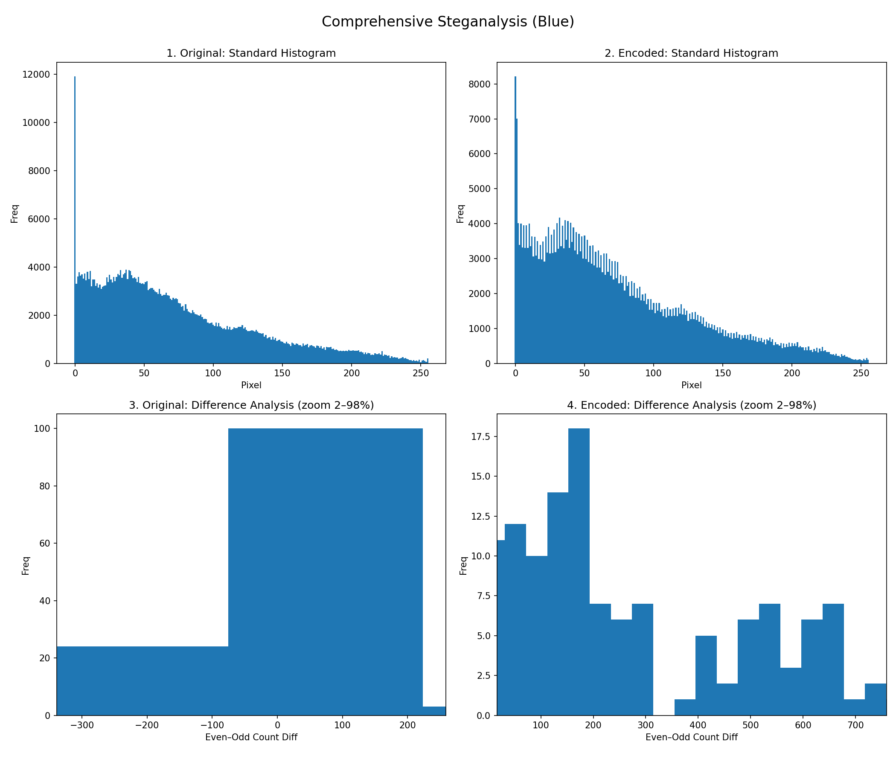

# Steganography Image Analyzer

<!-- TODO (Ethan): confirm or supply a subtitle. A draft used "Hiding in Plain Sight: A Practical Analysis of LSB Steganography", but no source for it was found in the repo or its history. -->

CS 5800 final project, Northeastern University, 2025.
Author: Ethan Doherty

## Overview

Steganography hides a message inside something that looks ordinary. In least significant bit (LSB) steganography, the message bits replace the lowest bit of each color value in an image. That changes each value by at most 1 out of 255, which the eye cannot see.

This project works on both sides. It hides text in PNG images and reads it back. It also does steganalysis: it measures the statistical traces that LSB embedding leaves in an image's color histogram, by comparing a cover image with its encoded version.

## Features

- **Command-line encoder and decoder** (`main.py`, built on `encoder.py` and `decoder.py`). Hides a text message in an image and recovers it.
- **Tkinter desktop app** (`gui.py`). Pick a PNG, optionally shrink it, type a message or fill the image to capacity, encode it, and view the original image, the encoded image and a four-panel analysis figure in tabs. It can also decode a PNG.
- **Steganalysis plots** (`steganalysis.py`). For one color channel (blue by default), plots the standard 256-bin histogram and the pairwise even/odd difference histogram for the cover and the stego image, as separate figures and as a 2x2 composite.
- **Pairwise statistics** (`pairwise_stats.py`). Computes the L1 norm, L2 norm, median and maximum of the even/odd pair differences for cover and stego. Prints the result as JSON and can save it as a JSON file and a LaTeX table.
- **Batch experiment runner** (`make_all.py`). From one cover image, builds three cases (full size at a low embedding rate, resized at a high rate, full size at a high rate) and runs the plots and statistics on each.

## How it works

### Embedding

1. **Text to bits.** Each character becomes `format(ord(c), '08b')`, which is 8 bits for ASCII and Latin-1 characters.
2. **End-of-message marker.** 64 zero bits (8 zero bytes) are appended.
3. **Writing the bits.** The image is converted to RGB. Pixels are visited in row-major order (top row first, left to right), and within each pixel the bits go into R, then G, then B. Each value becomes `(value & 0b11111110) | bit`: bit 0 is cleared and set to the message bit, and the other 7 bits stay the same.
4. **Saving.** The result is saved as PNG. Pixels after the last message bit are not touched, so a short message changes only the first rows of the image.

**Capacity** is 3 bits per pixel. The longest message is `floor(3 * width * height / 8) - 8` characters, because 8 bytes go to the marker. A 200x200 image holds 14,992 characters; an 800x534 image holds 160,192.

**Decoding** reads every LSB back in the same order, finds the first run of 64 zero bits, splits the bits before it into 8-bit groups and turns each group into a character with `chr()`.

### Why the output must be lossless (PNG)

The LSBs carry the least visible information in an image, and that is exactly what lossy compression throws away. Saving as JPEG changes many pixel values by small amounts, which scrambles the hidden bits. For example, re-saving a stego PNG as a quality-95 JPEG leaves nothing to decode ("Could not find message delimiter"). PNG is lossless, so every bit survives.

The encoder always writes PNG data, even if the output name ends in `.jpg`. The cover can be any format Pillow can open (PNG, BMP, JPEG and so on), because only the output has to be lossless.

## Steganalysis: the pairs-of-values idea

Let `h[v]` be the number of pixels whose channel value is `v`. Changing bit 0 can only move a value between `2k` and `2k+1`, never into a different pair. So the tools look at the 128 pair differences

```
Delta_k = h[2k] - h[2k+1],   k = 0..127
```

- **Random-looking payloads even out the pairs.** If the embedded bits are half 0s and half 1s, each changed pixel is equally likely to land on either value of its pair. The two counts drift toward each other, `Delta_k` shrinks toward 0, and the pairwise difference histogram collapses toward zero. This is the idea behind the Westfeld-Pfitzmann chi-square attack.
- **Plain-text payloads push the pairs one way.** When every LSB of a channel is overwritten, each pair's pixels split roughly in the payload's ratio of 0s to 1s, so `Delta_k ≈ (p0 - p1) * (h[2k] + h[2k+1])`. Every ASCII byte starts with a 0 bit, so text usually has more 0s than 1s (the default `make_all.py` message is 45.7% ones). Even values gain pixels and odd values lose them: `Delta_k` becomes positive for nearly every pair, and the standard histogram develops a comb of tall even bars next to short odd bars.

The payloads this project embeds are plain text (your message, the repeated default sentence in `make_all.py`, or Lorem ipsum in the GUI), so the committed results show the second pattern.

### Reading the figures



*`make_all.py`, full-size high-rate case: an 800x534 cover with every LSB overwritten by the repeated default message (blue channel).*

- **Panels 1 and 2 (standard histograms)** show how many pixels have each value from 0 to 255. The overall shape does not change, because no value moves by more than 1. At a high embedding rate with a text payload, panel 2 shows the comb: almost every even bar is taller than the odd bar next to it (127 of the 128 pairs in this run).
- **Panels 3 and 4 (pairwise difference histograms)** take the 128 values of `Delta_k` and plot how many pairs have each difference. The x-axis is the difference `h[2k] - h[2k+1]`, and the y-axis counts pairs. In the cover (panel 3), the differences fall on both sides of 0. In the stego image (panel 4), almost every difference is positive and larger, which is the text-payload signature described above. A random payload would instead squeeze them toward 0.

All 15 plots from run `20250811-171038` in `results/` (the `20250811-171038_*_b_*.png` files, composites and single plots) were made by an earlier version of `steganalysis.py`, so their titles and axis labels ("Freq", "(Blue)", "zoom 2–98%") differ from what the script draws today. The GUI plots (`comparison_analysis.png` and the `1_` to `4_` files) match the current format. The current code labels the panels "Standard" and "Pairwise", sets the x-axis of the pairwise panels to plus or minus the 98th percentile of `|Delta_k|` (so a few extreme pairs can fall outside the view), and prints `max|Δ|` in the corner.


*GUI output (`Run Full Analysis`) after `Resize for Test` (400x267) and `Fill Max Space` (about 40,000 characters of Lorem ipsum, essentially 100% of capacity). Same pattern: a comb in panel 2, and panel 4 shifted to the right. The largest imbalance drops from 429 to 219 while most other pairs gain a positive offset. This figure matches the current code's output format.*

### Numbers from the committed run

Blue channel, from `results/20250811-171038_*_pairwise.json` (cover `->` stego):

| Case | Image size | L1 of Delta | L2 of Delta | Median of abs(Delta) | Max of abs(Delta) |
|---|---|---|---|---|---|
| full-low (default 54-character message) | 800x534 | 19,786 -> 19,792 | 8,715.8 -> 8,716.2 | 60 -> 60 | 8,605 -> 8,605 |
| resized-high (filled to capacity) | 500x500 | 6,728 -> 21,646 | 2,106.7 -> 2,502.7 | 28 -> 121 | 2,033 -> 715 |
| full-high (filled to capacity) | 800x534 | 19,786 -> 36,924 | 8,715.8 -> 4,212.6 | 60 -> 190.5 | 8,605 -> 1,203 |

- **A short message in a large image is invisible to these statistics.** The default 54-character message overwrites only 496 LSBs (432 message bits plus the 64-bit marker), and L1 moves by 6 out of 19,786.
- **At full capacity, the statistics change a lot, but not always downward.** L1 and the median rise because of the text bias. The largest single imbalance (pair k = 0, the values 0 and 1, where the cover has a spike of pixels with blue value 0) gets evened out, and since L2 is dominated by that pair, L2 falls in the full-high case. The useful signal is that the pair structure changes, not that every number shrinks.

## Installation

Requires Python 3.10 or newer (`gui.py` uses `str | None` type hints). Tested with Python 3.13.7, numpy 2.5.4, Pillow 12.3.0 and matplotlib 3.11.2 on macOS.

```bash
git clone https://github.com/edoherty2017/steganography-image-analyzer.git
cd steganography-image-analyzer
python3 -m venv .venv
source .venv/bin/activate        # Windows: .venv\Scripts\activate
pip install -r requirements.txt
```

`tkinter` is only needed for `gui.py`. It is part of the Python standard library and cannot be installed with pip:

- The python.org installers already include it.
- Homebrew Python on macOS needs the separate formula that matches your Python version, for example `brew install python-tk@3.13`.
- On Debian or Ubuntu, run `sudo apt install python3-tk`.

## Usage

Run every command from the repository root with the virtual environment active.

No separate sample input is included (`test-images/` is in `.gitignore`). Any PNG photo works as a cover, including the committed `results/stego_resized.png` (a clean 400x267 cover the GUI made). The examples below use a synthetic 200x200 cover, which you can make with:

```bash
python -c "import numpy as np; from PIL import Image; y,x=np.mgrid[0:200,0:200]; g=np.stack([x,y,(x+y)//2],-1)*255/199; n=np.random.default_rng(0).normal(0,8,g.shape); Image.fromarray(np.clip(g+n,0,255).astype(np.uint8)).save('cover.png')"
```

### Encode and decode (`main.py`)

```bash
python main.py encode -i cover.png -m "Meet me at noon!" -o stego.png
python main.py decode -i stego.png
```

Output:

```
Successfully encoded message in 'stego.png'
Decoded Message Found:
Meet me at noon!
```

The example message ends with `!` on purpose. A message whose last character has an even character code (for example `t`, `d`, a space or `.`) loses that character on decode. See [Known limitations](#known-limitations).

A 16-character message changes so few pixels that the plots below look the same for cover and stego. To see the effect, fill the image close to capacity:

```bash
python main.py encode -i cover.png -m "$(python -c "print('Meet me at noon! ' * 880, end='')")" -o stego_full.png
```

That is 14,960 characters, which fits the 14,992-character capacity of the 200x200 synthetic cover. For another image, change 880 to about `capacity / 17`. Too long a message prints "Message is too large" and writes nothing.

### Steganalysis plots (`steganalysis.py`)

```bash
# Five figures in out/plots/: demo_b_std_cover.png, demo_b_std_stego.png,
# demo_b_pair_cover.png, demo_b_pair_stego.png and the 2x2 composite demo_b_comp.png
python steganalysis.py cover.png stego_full.png --out out/plots --tag demo --channel b

# The GUI's format: the composite at the given path, plus 1_original_standard_hist.png,
# 2_encoded_standard_hist.png, 3_original_difference_analysis.png and
# 4_encoded_difference_analysis.png in the same folder
python steganalysis.py cover.png stego_full.png -o out/gui/comparison_analysis.png
```

`--channel` takes `r`, `g` or `b` (default `b`). Give at least one of `--out` or `-o`. With neither, the script writes nothing.

### Pairwise statistics (`pairwise_stats.py`)

```bash
python pairwise_stats.py cover.png stego_full.png -c b --json out/stats/demo_pairwise.json --latex out/stats/demo_pairwise.tex --tag demo
```

- The JSON is always printed to stdout. `--json` and `--latex` also save it to files, creating folders as needed.
- For both `cover` and `stego`, the JSON holds `L1`, `L2`, `median_abs`, `max_abs` and `max_k` (the pair index of the largest difference). It also has a `delta` block with `L1_drop`, `L2_drop` and `median_abs_drop`, each computed as cover minus stego.
- The two images must have the same dimensions.
- `-c` also accepts `red`/`green`/`blue` or `0`/`1`/`2`.
- The LaTeX table needs the `booktabs` and `float` packages.

### Batch experiments (`make_all.py`)

```bash
python make_all.py cover.png --out out/experiment
```

This writes 25 files into `out/experiment/`. `RID` is the run's timestamp, `BASE` is the cover's file name without its extension, `CASE` is `full-low`, `resized-high` or `full-high`, and `CH` is the `--channel` letter (`b` by default):

- `BASE_RID_CASE_enc.png`: the stego image for each case.
- `BASE_RID_resized-high_resized.png`: the resized cover used in the resized-high case.
- `RID_CASE_CH_{std,pair}_{cover,stego}.png` and `RID_CASE_CH_comp.png`: the plots for each case.
- `RID_CASE_pairwise.json` and `RID_CASE_pairwise.tex`: the statistics for each case.

Options:

| Option | Default | Meaning |
|---|---|---|
| `--out` | `results` | Output folder. The default writes next to the committed results. |
| `--resize` | `500` | Side length of the square cover for the resized-high case. The aspect ratio is not kept. |
| `--channel` | `b` | Channel passed to both analysis scripts. Only `r`, `g` or `b` works: `steganalysis.py` rejects `red`, `0` and so on, and `make_all.py` then stops with `CalledProcessError` after writing the first stego image. |
| `--short` | `"I am a very sneaky dinosaur... Nobody knows I am here."` | Message for the low-rate case, and the unit that is repeated (with a space after each copy) for the high-rate cases. |
| `--long-multiplier` | `5000` | Repeat count for resized-high. Full-high uses 10 times this. Both payloads are cut to the image's capacity. |

`make_all.py` starts `python3 steganalysis.py` and `python3 pairwise_stats.py` as subprocesses by relative path. Run it from the repository root, with the virtual environment active so that `python3` is the right interpreter.

### Desktop app (`gui.py`)

```bash
python gui.py
```

1. **Select Image** (or Ctrl+O): choose a PNG. The "Remaining" counter shows how many characters still fit.
2. **Resize for Test** (optional): shrinks the image to fit within 400x400, keeping its aspect ratio, and saves it as `results/<name>_resized.png`.
3. Type a message, or press **Fill Max Space** to fill the image with repeated Lorem ipsum.
4. **Run Full Analysis**: encodes the message into `results/<name>_encoded.png` (or `results/<name>_resized_encoded.png` after Resize for Test), writes `results/comparison_analysis.png` plus the four single plots, and shows the original, encoded and analysis images in tabs.
5. **Decode Image**: choose any PNG. The hidden message appears in the text box.

The app writes into a `results/` folder in the current working directory and creates it at startup. When launched from the repository root, each analysis overwrites the committed `results/comparison_analysis.png` and the four `1_` to `4_` plots.

## Known limitations

Each item below was checked against the current code, most with a quick test.

**Message format**

- **The end marker can match too early.** The decoder searches for the first 64 zero bits at any bit position, not only at byte boundaries. If the last character has an even code, its trailing 0 bits join the marker and that character is lost: `"abcd"` decodes as `"abc"`, `"hi "` as `"hi"`, and `"Meet me at midnight"` as `"Meet me at midnigh"`. The default `make_all.py` message loses its final `.` the same way. Eight NUL characters inside a message also end it early, and the character before them can be lost too: `"ab"` + 8 NULs + `"cd!"` decodes as `"a"`.
- **Encoding uses `ord()`, not UTF-8.** Characters up to U+00FF round-trip as Latin-1 (`"café!"` works). A character above U+00FF needs more than 8 bits, which shifts every later byte out of alignment: `"€5"` decodes as `"\x82°"`. `make_all.py` has its own embedder that writes UTF-8 bytes, so for non-ASCII text the two embedders produce different bits.
- **There is no header, length field or signature.** The decoder cannot tell a stego image from a clean one. A clean image with a run of about 22 pixels whose R, G and B values are all even (pure black, for example) decodes as garbage: a test cover with a 3-row black band produced 3,749 characters of junk. If the run is at the very start of the image, the result is an empty string and `main.py decode` prints nothing.
- **There is no encryption.** Anyone who runs the decoder can read the message.

**Encoding and decoding**

- **Decoding time grows with image size, not message length.** The decoder walks every pixel in a Python loop and builds a Python string of 3 x width x height characters, with no early stop at the marker. On a 2000x2000 image with a 6-character message, encoding took about 0.3 s and decoding about 1.6 s. The encoder and the `make_all.py` embedder also loop over pixels in Python.
- **Handled errors still exit with status 0.** `encode()` and `decode()` print errors and return `None` instead of raising, so `main.py` exits with status 0 for a missing file, a message that is too long, or a missing marker. Only unhandled exceptions (for example a file that is not an image) exit with status 1. Encoder errors are printed to the terminal, not shown in the GUI.
- **The output is always PNG data, whatever its extension.** `-o out.jpg` produces a PNG file named `.jpg`.
- **Alpha channels are dropped.** RGBA, palette and grayscale covers are converted to RGB first.
- **JPEG destroys the message.** Re-saving a stego image as JPEG makes it undecodable.

**GUI**

- **File dialogs only offer `*.png`**, for both Select Image and Decode Image.
- **Messages are stripped.** Leading and trailing whitespace is removed before encoding.
- **The "Remaining" counter assumes one byte per character**, so it is wrong for characters above U+00FF.
- **Outputs always go to `results/`** under the current working directory, with fixed names that are overwritten on every run.

**Steganalysis**

- **Both images are required.** Every tool compares a cover with its own stego version. There is no blind detector that scores a single suspect image, and no chi-square test or p-value.
- **One channel per run**, blue by default.
- **Some labels always say "blue".** `analyze_comparison()` titles its four single plots "(Blue Channel)", and the default LaTeX captions (in `pairwise_stats.py` and all three in `make_all.py`) say "blue channel", even when another channel is chosen.
- **The LaTeX "Change (E-O)" row has inverted signs.** It actually prints Original minus Encoded. The JSON `*_drop` fields are also cover minus stego, so a negative value means the stego pairs are less equal.
- **`steganalysis.py` with neither `--out` nor `-o` writes nothing** and exits with status 0.

**Tooling**

- **`make_all.py` only works from the repository root.** It launches the helper scripts by relative path with whatever `python3` is first on `PATH`. Run from another folder, it fails with `CalledProcessError`.
- **`make_all.py` run tags have one-second resolution**, so two runs started in the same second with the same `--out` folder overwrite each other.
- **There is no automated test suite.**

## Project structure

| Path | Purpose |
|---|---|
| `encoder.py` | `encode()` and `message_to_binary()`: LSB embedding with the 64-zero-bit marker, PNG output. |
| `decoder.py` | `decode()`: reads the LSBs in the same order, finds the marker and rebuilds the text. |
| `main.py` | Command-line interface with `encode` and `decode` subcommands. |
| `gui.py` | Tkinter desktop app: encode, analyze and decode with image tabs. |
| `steganalysis.py` | Standard and pairwise histogram plots. `analyze()` is used by `make_all.py` (through `--out`); `analyze_comparison()` is used by the GUI (and `-o`). |
| `pairwise_stats.py` | Even/odd pair statistics (L1, L2, median, max) as JSON and a LaTeX table. |
| `make_all.py` | Three-case experiment runner with its own NumPy embedder (UTF-8 payload). Calls the two analysis scripts as subprocesses. |
| `results/` | Committed outputs. Run `20250811-171038` of `make_all.py` (plots, JSON, LaTeX, stego images), GUI outputs (`comparison_analysis.png`, the `1_` to `4_` plots, `stego_resized*.png`, `stego_encoded.png`) and two earlier low-rate stego images. File names start with `stego_` because the original cover was `test-images/stego.png`, which is not committed. `pairwise_stats_full._maxwords.tex` is a stray file that contains only the word "tree". |
| `requirements.txt` | Third-party packages: numpy, Pillow, matplotlib. |
| `.gitignore` | Ignores `.venv/`, `__pycache__/`, `test-images/`, `.DS_Store`, `.claude/` and `*.pyc`. |

## License

No license has been chosen yet.

<!-- TODO (Ethan): pick a license and add a LICENSE file. -->
