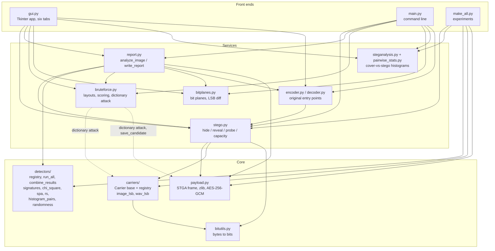
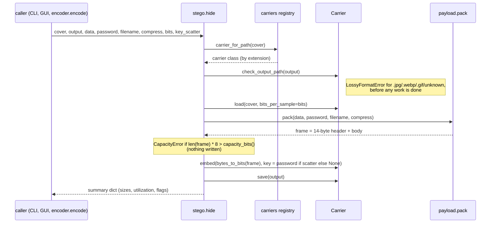
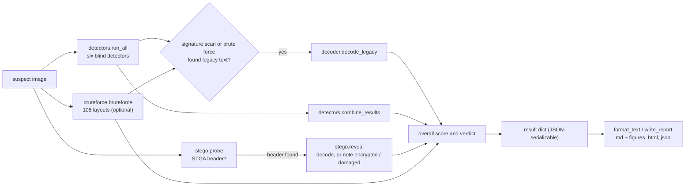

# Architecture

This document describes how the Steganography Image Analyzer is put together: the module layers, what happens when data is hidden, revealed and analyzed, and the two plug-in registries. The [README](../README.md) covers usage.

## Layers

The project is a set of flat top-level modules plus two plug-in packages. The front ends call the services, the services call the core, and no core module imports a service or a front end.



The project's internal imports, as they are in the code:

| Module | Imports at module level | Imports inside functions |
|---|---|---|
| `bitutils.py`, `payload.py`, `bitplanes.py`, `steganalysis.py`, `pairwise_stats.py` | (no project modules) | |
| `carriers/` | `bitutils` | |
| `detectors/` | (no project modules) | |
| `stego.py` | `payload`, `carriers`, `bitutils` | |
| `encoder.py` | `stego` | |
| `decoder.py` | `stego`, `carriers` | |
| `bruteforce.py` | | `carriers`, `payload` |
| `report.py` | `stego`, `detectors`, `bruteforce`, `bitplanes`, `payload` | `decoder` |
| `make_all.py` | `stego`, `payload`, `carriers`, `detectors`, `pairwise_stats` | `steganalysis` |
| `gui.py` | `stego`, `payload`, `carriers`, `detectors`, `report`, `bruteforce`, `bitplanes`, `steganalysis`, `pairwise_stats`, `decoder` | |
| `main.py` | | the same ten modules, each subcommand importing only what it needs |

Some of this is deliberate:

- **The detectors do not import `payload.py`.** The signature scan and the brute-force scorer each parse the 14-byte STGA header themselves, so the steganalysis side does not depend on the code that writes payloads.
- **`main.py` imports lazily.** Each subcommand imports what it needs, so `--help` and small commands start quickly.
- **No pyplot in the libraries.** `bitplanes.py` and `report.py` draw on a Matplotlib `Figure` with the Agg canvas and never import `matplotlib.pyplot`, so they cannot change the GUI's backend or leave figures open. `steganalysis.py` does use pyplot, so `gui.py` (and `main.py compare`) switch Matplotlib to Agg before importing it.

## Data flow

### Hide (`stego.hide`)



Inside `payload.pack` the body is built as: optional file-name record, then optional zlib, then optional AES-256-GCM (scrypt key, random salt and nonce). The header holds the magic `STGA`, the version (2), the flags, the body length and a CRC-32 over the first 10 header bytes followed by the body; those 10 bytes are also the GCM associated data.

Inside `Carrier.embed` the sample positions are `arange(n)` without a key, or the first `n` entries of a PCG64 permutation seeded from SHA-256(key) with one. Only the lowest `bits_per_sample` bits of each used sample change.

### Reveal (`stego.reveal`)

1. Pick the carrier from the file extension and load the file.
2. Find the header. For each bits-per-sample value (`bits`, or 1 and then 2 when `bits=None`) and each read order (the password's scatter order first when a password is given, then natural order), read exactly 112 bits and check them with `payload.parse_header`. If nothing matches, raise `NoPayloadError`.
3. Compute the frame length from the header. If it is larger than the carrier, raise `PayloadError` (the file was probably cropped).
4. Read exactly the frame's bits in the same order (every prefix of a scatter order is stable, so the header bits repeat) and call `payload.unpack`, which checks the CRC, then decrypts (`WrongPasswordError` on failure), then decompresses and splits off the file name.

`decoder.decode` calls `reveal(bits=None)` and, only on `NoPayloadError` for an image, falls back to `decode_legacy` (the original text-plus-64-zero-bits format, searched at byte boundaries). A damaged or encrypted frame is reported, never re-read as legacy text.

### Analyze (`report.analyze_image`)



The overall score starts from `combine_results` (the largest weighted detector score, plus 0.1 when SPA and RS both reach "suspicious"). A CRC-verified STGA frame sets it to 1.0 and a damaged one to 0.9, and the best brute-force candidate counts with weight 0.9. These are heuristics; the cut points are 0.35 (suspicious) and 0.65 (likely stego) everywhere.

`write_report` saves Markdown (with three PNG figures beside it: the bit-plane grid, the amplified LSBs and the even/odd histograms), one self-contained HTML page (figures embedded as base64), or the raw JSON.

## Plug-in registries

### Carriers (`carriers/`)

```python
from carriers import register, list_carriers, carrier_for_path
```

- `@register` adds a `Carrier` subclass to an ordered list. Registering twice is a no-op; anything that is not a `Carrier` subclass raises `TypeError`.
- `carrier_for_path(path)` matches the lowercase extension, first against every carrier's output `extensions`, then against every carrier's `cover_extensions` (formats it may read but never write, such as `.jpg` for the image carrier). The first match wins, so earlier registrations win ties. An unknown extension raises `ValueError` listing the supported ones.
- The built-in carriers register themselves when `carriers/__init__.py` imports `image_lsb` and `wav_lsb` at its bottom.

The `Carrier` base class (`carriers/base.py`) implements everything that is the same for every format: `capacity_bits`, `embed`, `extract`, key scatter (`scatter_order`, cached per key), `check_output_path` and `save`. A subclass supplies:

| Member | Contract |
|---|---|
| `name`, `description` | Identifier and one-line description (shown by `main.py plugins` and Help > About). |
| `extensions` | Lowercase extensions `save()` may write; they must keep the low bits intact. |
| `cover_extensions` | Optional extra extensions `load()` can read. |
| `load(cls, path, bits_per_sample=1)` | Read the file and return an instance. |
| `_samples(self)` | A 1-D, writable integer array that is a *view* of the carrier's data in natural order; `embed` writes into it in place. |
| `_write(self, path)` | Write the data back; the extension has already been checked. |

Everything above the registry (stego, decoder, bruteforce's dictionary attack, the GUI's file dialogs, `main.py plugins`) goes through `carrier_for_path` and never names a concrete class, which is why a new carrier needs no other change.

### Detectors (`detectors/`)

```python
import detectors
detectors.register(name, description)     # decorator
detectors.list_detectors()                # [{"name", "description"}], in registration order
detectors.run(name, image, channels="RGB")
detectors.run_all(image, channels="RGB")  # {name: result}
detectors.combine_results(results)        # {score, verdict, driver, flagged}
```

- A detector is a function `f(arr)` (or `f(arr, channel_names=...)`) taking an `(H, W, C)` uint8 array. `run` and `run_all` accept a path, a PIL image or an array, convert it to RGB and select and order the channels (`"RGB"`, `"B"`, `"BGR"`, ...).
- Every result has the same shape: `{"name", "score" in [0, 1], "verdict", "summary", "details"}`. The verdict always comes from the score with the shared cut points. `detectors._common.make_result` builds it, clips the score and converts `details` to plain JSON types (NaN becomes `None`).
- `run_all` re-normalizes every result through `make_result`, so a third-party detector that returns a loose dict still fits the schema. A detector that raises is contained: it gets score 0 and `details["error"]` instead of sinking the whole report.
- Registering a different function under an existing name raises `ValueError`. The built-ins are imported at the bottom of `detectors/__init__.py`, and that import order is the run order.
- `combine_results` weighs each detector (`COMBINE_WEIGHTS`; detectors it does not know weigh 0.75).

### Brute-force strategies (`bruteforce.py`)

Not a registry, but the third extension point. `Strategy(channels, bit, bit_order, traversal, depth=1)` describes one way to read bits back, and `enumerate_strategies(max_bit=1, has_alpha=False, two_bit=True)` lists them: 9 channel orders x bit planes x MSB/LSB-first x row/column, plus 2-bit layouts (108 by default, with the original layout first). `score_candidate` ranks the extracted bytes with heuristics (STGA frame, file signatures walked to their end, the original text format, text runs, noise). New layouts or file types are added in this module.

## Errors

Every expected failure is a `ValueError` subclass with a message meant for the user:

```text
ValueError
 +-- payload.PayloadError         not a frame, damaged frame (CRC), truncated, malformed
 |    +-- payload.WrongPasswordError  encrypted frame, password missing or wrong
 |    +-- stego.NoPayloadError        no valid header in any read order tried
 +-- carriers.base.CapacityError  payload does not fit / read past the end
 +-- carriers.base.LossyFormatError  output extension is lossy or unknown
```

`main.py` turns these (and `FileNotFoundError`, other `OSError`s and `wave.Error`) into `main.py: error: ...` on stderr with exit status 1. The GUI shows a separate message for each kind.

## Desktop app threading

Tk is not thread-safe, so `gui.py` keeps all widget work on the Tk thread. `SteganoApp.run_in_background()` runs a worker function on a daemon thread; the worker gets only plain values (paths, strings, numbers) and returns plain values or PIL images. Its result or exception goes into a `queue.Queue`, and a `root.after()` poll every 50 ms hands it to the callbacks on the Tk thread. Each tab disables its buttons while its job runs. Matplotlib is switched to the Agg backend before `steganalysis` is imported, so figures can be drawn on the worker thread and are shown as saved PNGs.

## Tests

`tests/` mirrors the modules (`test_payload.py`, `test_carriers.py`, `test_stego.py`, `test_detectors.py`, `test_bruteforce.py`, `test_bitplanes.py`, `test_report.py`, `test_cli.py`, `test_gui.py`, `test_experiments.py`, `test_legacy.py`, `test_bitutils.py`), plus `test_detectors_init.py` (registry and score combination), `test_rate_estimators.py` (SPA/RS rate estimates), `test_steganalysis.py` (histogram comparison), `test_results_tables.py` (committed LaTeX tables) and `test_readme.py` (the README quick start). Shared fixtures are in `tests/conftest.py`: `synthetic_rgb(seed, size)` builds a smooth, mildly noisy RGB cover, and `save_png` writes arrays into the test's temporary folder. The CLI tests run `main.py` as a subprocess; the GUI tests build a hidden Tk root and skip when no display is available. `pyproject.toml` sets `pythonpath = ["."]` and `testpaths = ["tests"]`, so both `pytest` and `python -m pytest` work from the repository root.
